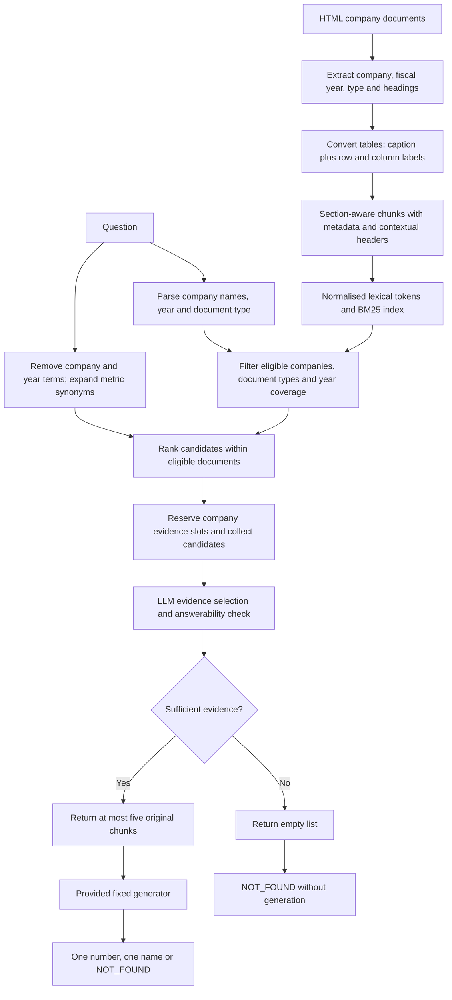

# FTEC5660 Homework 4

## Homework 4 solution

### Pipeline

BeautifulSoup extracts document identity and section structure. `table_to_text` expands row/column relationships, preserves the caption and units, and handles spanning cells so that values remain attached to their labels. `chunk_document` groups prose by section and keeps tables separate, repeating captions when a table is divided; a final character-based splitter respects the 1,500-character limit, including the header. Chunks carry source, company, fiscal year and document type, with additional section/table metadata and broker/report identity for research reports. `build_index` creates BM25 over lowercased, normalised tokens with stop-word removal and simple plural normalisation. Query parsing combines rules with the allowed LLM; exact company/type filtering prevents similarly named entities from being mixed, while year filtering accounts for prior-year annual-report columns and forward-looking guidance/forecasts. The lexical ranking query removes company/year terms and expands financial synonyms. The full system reserves an initial slot per requested company, gathers a small candidate pool, and asks the allowed LLM to select existing passage IDs and check answerability. Unknown companies, unsupported periods and insufficient evidence lead to `[]`. Returned text is always an original chunk; the provided generator, prompt and scoring code are unchanged. These choices aim to preserve exact financial evidence while preventing wrong-company, wrong-year and unsupported answers.

### Cumulative ablation results

| Variant | Only change from previous row | Recall@5 | Kept | Rejected | Accuracy |
|---|---|---:|---:|---:|---:|
| B0 | Naive get_text + recursive splitting + whitespace BM25 top-5 | 39.1% | 100.0% | 0.0% | 46.7% |
| V1 | Add table-to-text conversion | 32.6% | 100.0% | 0.0% | 48.3% |
| V2 | Replace recursive splitting with section/table-aware splitting | 21.7% | 100.0% | 0.0% | 40.0% |
| V3 | Add contextual chunk headers, including research broker and report title | 26.1% | 100.0% | 0.0% | 41.7% |
| V4 | Add company/type/year metadata filtering | 84.8% | 97.8% | 71.4% | 88.3% |
| V5 | Replace whitespace tokenisation with normalised tokenisation | 80.4% | 97.8% | 71.4% | 86.7% |
| V6 | Add query rewriting: remove entity/year terms and expand synonyms | 100.0% | 100.0% | 71.4% | 98.3% |
| V7 | Add table score boost | 100.0% | 100.0% | 71.4% | 98.3% |
| V8 | Reserve an evidence slot for each comparison company | 100.0% | 100.0% | 71.4% | 100.0% |
| V9 | Add LLM reranking | 97.8% | 97.8% | 71.4% | 96.7% |
| V10 | Apply the reranker answerability decision | 100.0% | 100.0% | 100.0% | 98.3% |

The table reports one run on public_test and is generated from the saved per-question CSVs. Recall@5 and Kept are measured over the 46 answerable questions, Rejected over the 14 unanswerable questions, and Accuracy over all 60. The final V10 run achieved 59/60 correct answers, 46/46 evidence hits, 46/46 answerable questions retained, and 14/14 unanswerable questions rejected.

### Analysis of each change

- **B0 to V1: table conversion.** Recall fell from 39.1% to 32.6%, while accuracy rose from 46.7% to 48.3% (one question). Preserving table labels is useful for faithful financial evidence, but it also changes token frequencies and chunk boundaries. This experiment does not show a standalone recall gain from table conversion. The token-frequency/boundary explanation is a hypothesis, not a separately isolated measurement.
- **V1 to V2: section/table-aware splitting.** Recall fell to 21.7% and accuracy to 40.0%. Preserving document structure alone did not solve corpus-wide lexical confusion; the candidate ranking still lacked metadata filtering. Smaller or differently grouped evidence may also change BM25 ranking.
- **V2 to V3: contextual headers.** Recall rose to 26.1% and accuracy to 41.7%. Repeated section and research identity can help recover context, but the gain was small before entity filtering.
- **V3 to V4: metadata filtering.** This produced the largest improvement: recall rose by 58.7 percentage points to 84.8%, and accuracy by 46.7 points to 88.3%. Restricting retrieval by company, type and covered year sharply reduces irrelevant candidates. Filtering also rejected 10/14 unanswerable questions, but one answerable question was rejected.
- **V4 to V5: normalised tokenisation.** Recall fell to 80.4% and accuracy to 86.7%. Stop-word removal and plural normalisation were not independently beneficial under this query formulation. Normalising tokens can discard distinctions or change relative term weights; that mechanism would need targeted tests to confirm.
- **V5 to V6: query rewriting and synonym expansion.** Recall reached 100.0%, Kept reached 100.0%, and accuracy reached 98.3%. Once metadata handles identity and period, removing those terms lets BM25 focus on the financial metric, while synonyms bridge differences in wording. This was the strongest improvement after filtering.
- **V6 to V7: table-score switch.** All reported metrics were unchanged. Code inspection found an important implementation limitation: this switch boosts within-company ordering, but before V8 the global merge re-sorts candidates using raw BM25 scores. Thus the standalone boost is overwritten and V7 is effectively a no-op for final selection. This is a negative implementation finding, not evidence that table boosting in general is useless. The submitted implementation and the measured results are retained without claiming an effective standalone boost.
- **V7 to V8: company-slot selection.** Accuracy reached 100.0% with recall unchanged. This stage reserves one initial chunk per company before filling remaining slots; it also applies that selection procedure to single-company questions, allowing the within-group boosted ordering to reach the output. Consequently, this row tests the implemented selection policy, not a clean comparison-only effect. In particular, the corrected regional-revenue question discussed below is a single-company question.
- **V8 to V9: LLM evidence selection.** Recall and Kept fell to 97.8%, and accuracy to 96.7%. The recorded query parser also changed for q029, incorrectly including the broker as a subject company; that failure happens before reranking. Therefore the full two-question drop cannot be causally assigned to the reranker alone. LLM-based selection adds latency and can introduce errors, and a single run is insufficient to establish an independent benefit.
- **V9 to V10: answerability rejection.** Rejected rose from 71.4% to 100.0%. Recall and Kept also returned to 100.0%, and accuracy rose to 98.3%. The recovery of q029 reflects a different query-parse result across runs, rather than proof that rejection improves parsing. The direct intended benefit is that unsupported questions are rejected by the retriever itself.

Although V8 had perfect answer accuracy in this public run, its retrieval rejected only 10/14 unanswerable questions. The final system retains the answerability check because Task 3 evaluates the retriever's decision, not merely whether the generator eventually says NOT_FOUND. No claim is made that adding every component monotonically improves performance.

### Error analysis

1. **Remaining final error: q037, comparison.** The question asks which company had higher FY2024 operating income, Northgate Robotics or Brightwater Software. The final run retrieved `doc_027.html` and `doc_028.html` and passed the evidence-hit check. The reference figures are 307.6 for Northgate Robotics and 260.1 for Brightwater Software (USD millions), so the expected answer is Northgate Robotics. The generator instead returned Brightwater Software. This demonstrates that evidence recall is not sufficient for answer accuracy: selected context can contain distracting rows, year columns or rounded figures. The stored CSVs do not include full chunk text or a model rationale, so the exact internal cause cannot be established from the record. More targeted evidence around the requested row/year would be a future improvement.
2. **q029 in V9, entity parsing.** The parser treated Meridian Equity Research as a subject company alongside Sablewood Retail. Company filtering then returned no chunks and the answer was NOT_FOUND, although the forecast exists in `doc_010.html` (2,605.8). V10 parsed the subject correctly and answered correctly. This illustrates a broker/company distinction failure and cross-run LLM variability, not a demonstrated reranking failure.
3. **q050 in V6/V7, regional table interpretation.** The question asks for Brightwater Software's FY2023 revenue in Europe, Middle East and Africa. Both variants hit the reference evidence in `doc_027.html`, but answered 158.1 rather than 493.5. V8 answered correctly. The implementation changes the selection ordering even for single-company questions, so this improvement must not be described as proof of comparison coverage alone. Again, the record establishes a wrong-value answer despite evidence recall, not the exact row the generator used.

The final category accuracies were 12/12 fact, 22/22 table, 11/12 comparison and 14/14 unanswerable. These findings suggest prioritising precise row/year presentation and robust entity parsing over adding complexity solely to raise public-set scores.

## Task 6: Reflection

If AI agents become good at most of the work I am studying for, I would still want to be someone who understands the decisions being made. Getting a useful answer is valuable, but I would not feel comfortable approving a financial decision just because an agent gave a confident explanation. I want to know enough to ask a second question, notice when something does not add up, and explain my choice to the person affected by it.

Some of my ambitions would stay the same. I would still want financial independence, work I find interesting, and the ability to help the people close to me. What might change is how I measure progress. Finishing more tasks than everyone else would mean less when everyone has similar tools. I would care more about whether the work solves a real problem and whether I can be relied on when the answer is unclear. Outside work, I would like people to remember that I keep my word and make time for them. An agent could help me organise my day, but it could not be a good friend on my behalf.

There are also things I would still choose to do the slower way. I would want to understand the basic reasoning behind a program before depending on it. Reading a difficult explanation, trying an idea, and finding out why it fails can be frustrating, but that effort changes what I am able to notice next time. I would not insist on doing every routine step myself. The distinction I would try to make is whether I am saving time on repetition or skipping the part that would teach me something.

This homework makes that distinction quite concrete. A recall score of 100% looked reassuring, yet the final system still gave a wrong company name for a comparison. It had access to the required evidence. The missing step was using that evidence correctly. The ablation results also looked easy to explain until I checked the code: the table-score boost was overwritten before the global selection, so an unchanged score could not tell me whether the underlying idea was useful. These are small examples, but they show why reading outputs and checking how they were produced remain useful skills.

I think domain knowledge, clear communication and the willingness to admit uncertainty would still matter. So would experience working with people whose needs differ from mine. If I define myself only by the tasks I can complete, every improvement in AI becomes a threat. I would rather define myself partly by the choices I make: what I give my attention to, which responsibilities I accept, and how I behave when nobody is checking the result. I do not need to outperform an agent at every task for those choices to have value.

Starting tomorrow, I would make one practical change to how I study: before asking for a finished solution, write down my own approach and one thing I am unsure about. Then use AI to test that approach, rather than simply replace it. For important outputs, I would check a small number of concrete cases and keep a short record of mistakes. I would also keep time away from coursework and tools, because health and relationships should not become whatever is left after the work is done.

